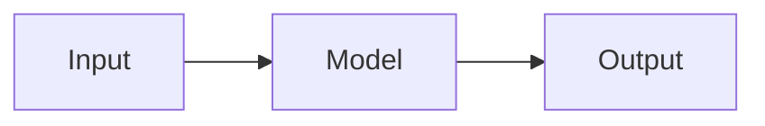
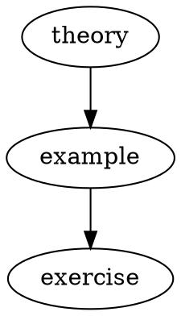

# Extension showcase

This document is a browser regression fixture. It combines independent
extension blocks and their resources. It is not the package's public API
documentation.

Read the [fixture notes](extension-showcase-notes.md).

### Repeated example heading

### Repeated example heading

```javascript
const value = 2;
```

Inline TeX: $x^2+1$. Protected TeX: $`a_b+c`$.

```math
\frac{1}{2}
```



```smiles
CCO
```

```abc
X:1
T:Scale
M:4/4
L:1/4
K:C
C D E F | G A B c |
```

```mei
<?xml version="1.0" encoding="UTF-8"?>
<mei xmlns="http://www.music-encoding.org/ns/mei" meiversion="5.0">
  <meiHead><fileDesc><titleStmt><title>One note</title></titleStmt><pubStmt/></fileDesc></meiHead>
  <music><body><mdiv><score><scoreDef meter.count="4" meter.unit="4"><staffGrp><staffDef n="1" lines="5" clef.shape="G" clef.line="2"/></staffGrp></scoreDef><section><measure n="1"><staff n="1"><layer n="1"><note pname="c" oct="4" dur="1"/></layer></staff></measure></section></score></mdiv></body></music>
</mei>
```

```musicxml
<?xml version="1.0" encoding="UTF-8"?>
<score-partwise version="4.0">
  <part-list><score-part id="P1"><part-name>Music</part-name></score-part></part-list>
  <part id="P1"><measure number="1"><attributes><divisions>1</divisions><time><beats>4</beats><beat-type>4</beat-type></time><clef><sign>G</sign><line>2</line></clef></attributes><note><pitch><step>C</step><octave>4</octave></pitch><duration>4</duration><type>whole</type></note></measure></part>
</score-partwise>
```

```geojson
{
    "type": "FeatureCollection",
    "features": [
        {
            "type": "Feature",
            "properties": {
                "name": "Triangle"
            },
            "geometry": {
                "type": "Polygon",
                "coordinates": [
                    [
                        [
                            -47,
                            -23
                        ],
                        [
                            -46,
                            -23
                        ],
                        [
                            -46.5,
                            -22
                        ],
                        [
                            -47,
                            -23
                        ]
                    ]
                ]
            }
        },
        {
            "type": "Feature",
            "properties": {
                "name": "Point"
            },
            "geometry": {
                "type": "Point",
                "coordinates": [
                    -46.5,
                    -22.7
                ]
            }
        }
    ]
}
```

```topojson
{
    "type": "Topology",
    "objects": {
        "point": {
            "type": "Point",
            "coordinates": [
                -46.5,
                -23
            ]
        }
    },
    "arcs": []
}
```

```vega-lite
{
    "data":{"values":[{"group":"A","value":2},{"group":"B","value":5}]},
    "mark":"bar",
    "encoding":{"x":{"field":"group","type":"nominal"},"y":{"field":"value","type":"quantitative"}}
}
```



```pdb
HETATM    1  O   HOH A   1       0.000   0.000   0.000  1.00 20.00           O
HETATM    2  H1  HOH A   1       0.759   0.000   0.504  1.00 20.00           H
HETATM    3  H2  HOH A   1      -0.759   0.000   0.504  1.00 20.00           H
END
```

```xyz
5
methane
C 0 0 0
H 0.629 0.629 0.629
H -0.629 -0.629 0.629
H -0.629 0.629 -0.629
H 0.629 -0.629 -0.629
```

```stl
solid triangle
facet normal 0 0 1
outer loop
vertex -1 0 0
vertex 1 0 0
vertex 0 1 0
endloop
endfacet
endsolid triangle
```

```obj
o triangle
v -1 0 0
v 1 0 0
v 0 1 0
f 1 2 3
```

```mathjslab
values = [1,2,3];
plot(values,values.^2);
```

```mathjslab
plot([1,4,2,5]);
```
